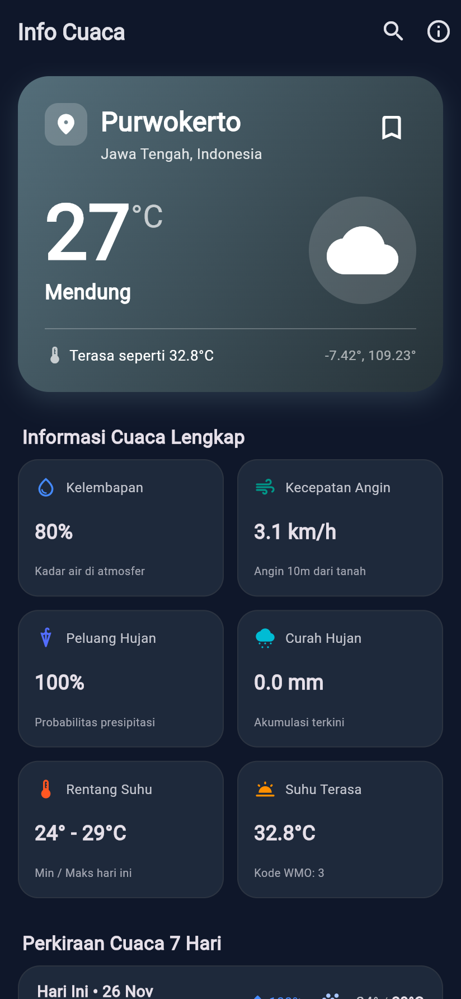
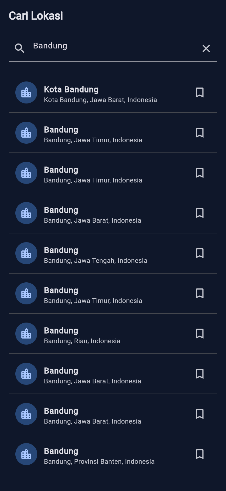
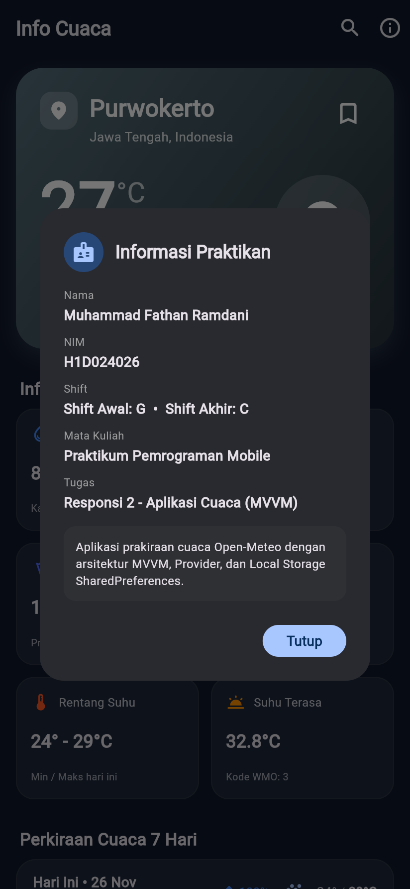

# Responsi 2 Praktikum Pemrograman Mobile
## Aplikasi Pemantau Cuaca (Weather App)

Tugas ini disusun untuk memenuhi penilaian Responsi 2 Praktikum Pemrograman Mobile.

* **Nama Mahasiswa:** Muhammad Fathan Ramdani
* **NIM:** H1D024026
* **Shift Awal:** G
* **Shift Akhir:** C
* **Teknologi:** Flutter (Dart)
* **Arsitektur:** Model-View-ViewModel (MVVM)
* **Sumber Data:** Open-Meteo API (Forecast & Geocoding)

---

### Deskripsi Proyek

Aplikasi ini merupakan aplikasi ramalan cuaca berbasis mobile yang dibuat menggunakan framework Flutter. Aplikasi ini dapat menampilkan data cuaca real-time di suatu lokasi kota (default: Purwokerto) dan perkiraan cuaca 7 hari ke depan. Pengguna juga dapat mencari kota lain di seluruh dunia, menyimpan kota ke daftar favorit, dan melihat riwayat pencarian sebelumnya menggunakan penyimpanan lokal (SharedPreferences).

---

### Penerapan Arsitektur MVVM (Model-View-ViewModel)

Aplikasi ini dirancang mengikuti pola arsitektur **MVVM** agar kode terstruktur rapi, modular, dan memisahkan logika data dengan tampilan UI:

1. **Model (`lib/data/models/`)**
   * `LocationModel.dart`: Menyimpan representasi data lokasi (id, nama kota, provinsi/admin1, negara, koordinat latitude & longitude, status favorit). Dilengkapi method serialisasi `fromJson` dan `toJson` untuk penyimpanan lokal.
   * `WeatherModel.dart`: Menyimpan representasi data cuaca dari respon JSON Open-Meteo, terdiri dari:
     - `CurrentWeather`: data suhu terkini, kelembapan udara, suhu yang dirasakan (apparent temperature), curah hujan, kode cuaca WMO, dan kecepatan angin.
     - `DailyForecastItem`: data ramalan harian berupa tanggal, kode cuaca, suhu maksimal, suhu minimal, dan peluang hujan (precipitation probability).
     - `WeatherData`: pembungkus data cuaca lengkap beserta koordinat dan timezone.

2. **ViewModel (`lib/viewmodels/`)**
   * Menggunakan package `provider` dengan kelas turunan `ChangeNotifier`.
   * `WeatherViewModel.dart`: Mengelola state utama aplikasi cuaca, menangani pemanggilan data cuaca dari API, memperbarui data saat refresh (pull-to-refresh), memuat serta mengubah status lokasi favorit, dan mengelola daftar riwayat pencarian yang disimpan ke SharedPreferences.
   * `LocationSearchViewModel.dart`: Mengelola proses pencarian kota ke Open-Meteo Geocoding API secara real-time dengan mekanisme debounce (500ms) agar request tidak spam saat pengguna mengetik, serta mengatur state pencarian (idle, loading, success, empty, error).

3. **View (`lib/views/`)**
   * Bertugas hanya untuk merender tampilan antarmuka (UI) dan menerima interaksi pengguna.
   * `WeatherScreen.dart`: Layar beranda utama yang menampilkan kartu cuaca utama (hero card), grid detail metrik cuaca lengkap, serta list perkiraan cuaca 7 hari.
   * `LocationSearchScreen.dart`: Layar pencarian yang memiliki search bar, daftar hasil pencarian dari Geocoding API, daftar lokasi favorit yang tersimpan, dan daftar riwayat pencarian terakhir.
   * `StudentInfoDialog.dart`: Dialog modal yang menampilkan data diri mahasiswa/praktikan.
   * `lib/views/widgets/`: Komponen widget modular seperti `WeatherHeroCard`, `WeatherDetailGrid`, dan `DailyForecastList`.

---

### Implementasi REST API & Networking

Aplikasi menggunakan REST API resmi dari **Open-Meteo** (tanpa memerlukan API key berbayar):

1. **Weather Forecast API**
   * Endpoint: `https://api.open-meteo.com/v1/forecast`
   * Metode: `GET`
   * Parameter:
     - `latitude` & `longitude`: Koordinat lokasi kota yang dipilih
     - `current`: `temperature_2m,relative_humidity_2m,apparent_temperature,precipitation,weather_code,wind_speed_10m`
     - `daily`: `weather_code,temperature_2m_max,temperature_2m_min,precipitation_probability_max`
     - `timezone`: `auto`
     - `forecast_days`: `7`
   * Semua data yang tampil murni berasal dari respon API yang di-parse ke objek Dart.

2. **Geocoding API**
   * Endpoint: `https://geocoding-api.open-meteo.com/v1/search`
   * Metode: `GET`
   * Parameter: `name={query}`, `count=10`, `language=id`, `format=json`
   * Mengembalikan daftar kota yang cocok dengan kata kunci pencarian pengguna.

3. **Penanganan Status (State & Error Handling)**
   * Loading: Menampilkan indikator loading saat proses request berlangsung.
   * Error: Menangani kendala koneksi internet (`SocketException`), timeout request (`TimeoutException`), atau error HTTP dengan menampilkan pesan jelas beserta tombol "Coba Lagi".
   * Empty: Menampilkan ilustrasi dan teks informatif jika pencarian kota tidak ditemukan.

---

### Implementasi Local Storage

Penyimpanan lokal diimplementasikan pada `LocalStorageService.dart` menggunakan library **`shared_preferences`**:
* Menyimpan daftar kota favorit dalam format JSON string list (`favorite_locations`).
* Menyimpan riwayat pencarian kota terakhir (`recent_searches`).
* Menyimpan lokasi terakhir yang sedang dibuka pengguna (`last_selected_location`), sehingga ketika aplikasi ditutup dan dibuka kembali, aplikasi langsung menampilkan cuaca dari kota terakhir yang dipilih.

---

### Screenshot Antarmuka Aplikasi

Berikut adalah hasil tangkapan layar dari screen aplikasi yang telah berjalan:

#### 1. Home / Weather Screen (Layar Utama Cuaca)
Menampilkan nama kota aktif (Purwokerto), kondisi cuaca terkini, suhu, suhu yang dirasakan, kelembapan, kecepatan angin, peluang hujan, curah hujan, rentang suhu hari ini, dan perkiraan cuaca 7 hari ke depan.



---

#### 2. Search / Location Screen (Favorit & Riwayat Pencarian)
Menampilkan input pencarian kota, daftar lokasi favorit yang tersimpan di penyimpanan lokal, dan riwayat kota yang pernah dicari.


---

#### 3. Search Results (Hasil Pencarian Kota via Open-Meteo API)
Menampilkan daftar kota yang didapat secara langsung dari Open-Meteo Geocoding API saat pengguna mengetik nama kota (misal: "Bandung"). Terdapat tombol bookmark untuk langsung menyimpan ke favorit.



---

#### 4. Dialog Informasi Praktikan
Menampilkan dialog profil identitas mahasiswa pengerja tugas responsi.



---

### Panduan Menjalankan Aplikasi

1. Pastikan Flutter SDK sudah terpasang di komputer (versi 3.14.0 atau lebih baru).
2. Clone repository ini:
   ```bash
   git clone https://github.com/MFathanrmd/H1D024026-MFathanR-Responsi-Flutter.git
   ```
3. Masuk ke direktori folder proyek:
   ```bash
   cd H1D024026-MFathanR-Responsi-Flutter
   ```
4. Ambil semua dependencies yang dibutuhkan:
   ```bash
   flutter pub get
   ```
5. Jalankan aplikasi pada emulator atau perangkat fisik (Android / Chrome / Windows):
   ```bash
   flutter run
   ```
6. Menjalankan pengujian otomatis:
   ```bash
   flutter test
   ```
